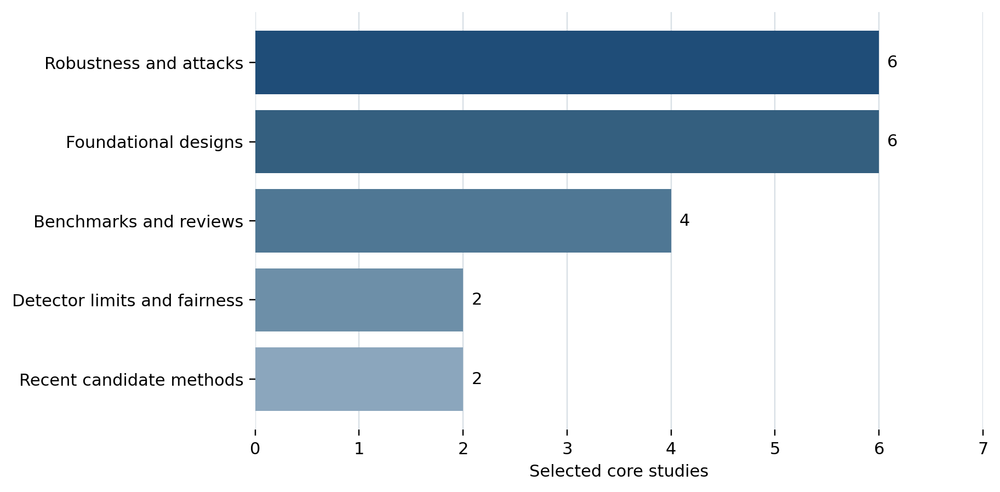
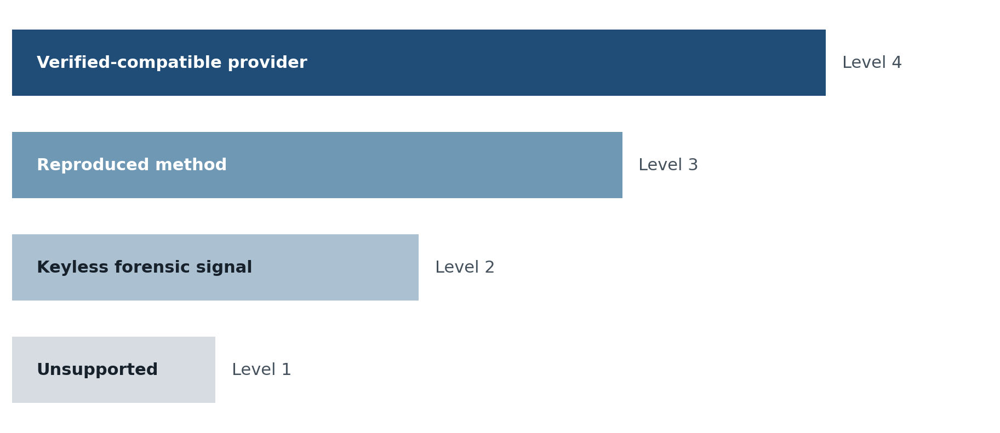

**RESEARCH MANUSCRIPT**

**Detecting and Measuring Statistical Watermarks in Large Language Model Text: A Security-Oriented Evidence Synthesis and System Design**

IMRAD evidence synthesis and implementation design

**Daniel Boles \| August 14, 2026**

*Design and evidence draft. Empirical application validation is pending.*

# Abstract

Statistical text watermarking has emerged as a proposed mechanism for identifying and attributing large language model output. However, operational use is complicated by editing, paraphrasing, translation, mixed-source documents, spoofing, tokenizer dependence, secret-key management, and false-positive risk. This study synthesizes 20 foundational, evaluative, adversarial, and recent papers published or released between 2023 and August 2026 and translates that evidence into a security-oriented application design. The review separates keyed watermark verification from generic stylistic detection and distinguishes watermark presence from provider attribution and human authorship. The proposed system implements independent method adapters for KGW-style, MCmark-inspired, and MirrorMark-inspired watermarking; immutable run manifests; matched calibration; controlled attack simulation; a provider-neutral model ensemble; and a Docker-based mock provider. The evidence indicates that watermarking can provide useful provenance evidence under compatible and calibrated conditions, but no reviewed method simultaneously guarantees invisibility, quality, robustness, public verification, spoof resistance, and reliable payload recovery. Translation and strong paraphrasing remain particularly important threats. The paper concludes that watermark results should support a layered provenance review rather than automatic authorship judgments. It also proposes a dual-model paper-ingestion process in which Kimi 2.7 Code develops equation-to-code specifications and GLM 5.2 independently audits them before implementation.

*Section 4.2 discusses mitigation only to set the limits of the proposed detection and testing design. The accompanying repository ships no tooling for removing watermarks.*

**Keywords:** large language models; text watermarking; AI-generated text detection; provenance; adversarial NLP; cybersecurity; paraphrasing; translation; statistical forensics

# 1. Introduction

The rapid adoption of large language models has created demand for technical mechanisms that can identify generated or processed content. Statistical text watermarking is attractive because a model can influence token selection during generation in a way that is difficult for an ordinary reader to notice but detectable by a party with a compatible algorithm and, commonly, a secret key. This differs from post hoc style classification, which estimates whether text resembles examples labeled as human or machine generated.

The distinction has legal, academic, and cybersecurity consequences. Generic detectors have shown sensitivity to domain, model, decoding strategy, paraphrasing, and non-native English writing (Dugan et al., 2024; Liang et al., 2023; Sadasivan et al., 2023). A keyed watermark detector is more specific, but specificity does not eliminate uncertainty. Detection depends on tokenizer compatibility, normalization, sample length, entropy, threshold calibration, key policy, and the transformations applied after generation.

Provider documentation can also define detection more broadly than authorship. Anthropic currently states that supported Claude models embed imperceptible text marks and that a positive result may indicate processing by Claude, including proofreading, translation, summarization, or conversion. This interpretation means a human-authored manuscript could acquire a mark during a legitimate language service. Conversely, extensive editing or unsupported model versions may remove or prevent detection. A watermark result therefore cannot be interpreted responsibly without workflow provenance.

Security analysis must consider both watermark construction and adversarial response. An attacker may remove evidence through paraphrasing, translation, insertion, deletion, or mixed-source composition. A public or learned watermark may also be spoofed. A defender can improve robustness, restrict detector access, rotate keys, and preserve signed logs, but each control creates trade-offs involving verifiability, usability, cost, and long-term compatibility.

This paper addresses three research questions:

1.  What does the recent academic literature establish about detecting LLM text watermarks, and about the robustness and spoofing limits of that detection?

2.  How should a research application represent uncertainty and prevent watermark evidence from becoming an unsupported provider or authorship claim?

3.  Which technical architecture best supports reproducible method implementation, cross-method comparison, security controls, and future provider integration?

The contribution is a structured evidence synthesis and an implementation-ready system design. It does not claim a new empirical detector. Instead, it specifies how future experiments should be conducted and how research implementations should be prevented from overstating compatibility.

# 2. Methods

## 2.1 Review scope and source discovery

The review focused on generation-time text watermarking and directly relevant evidence concerning detection, robustness, attacks, generic detector limitations, fairness, benchmarking, and provider affiliation. Training-data watermarks, model-weight watermarks, image watermarking, and simple Unicode steganography were excluded unless they clarified a security property or threat model.

Discovery combined title, topic, author-affiliation, citation-network, and persistent-identifier searches in Google Scholar, Semantic Scholar, Crossref, OpenAlex-linked records, DBLP, ACL Anthology, PMLR, OpenReview, IEEE, ACM, Nature, NeurIPS proceedings, and arXiv. Indexes were used for discovery and bibliographic reconciliation. Substantive claims were verified in primary papers or official provider documentation.

The main search concepts were: language model watermark; LLM text watermark; unbiased watermark; distortion-free watermark; multi-bit watermark; watermark paraphrase; watermark translation; watermark spoofing; watermark stealing; AI detector false positive; non-native English detector bias; and Anthropic author affiliation.

## 2.2 Selection and classification

Papers were retained when they met at least one criterion:

1.  Introduced a foundational watermark construction.

2.  Evaluated editing, paraphrasing, translation, spoofing, stealing, or removal.

3.  Established a theoretical limit or security trade-off.

4.  Provided a benchmark, survey, or systematization.

5.  Supplied directly relevant evidence about generic detector reliability or fairness.

6.  Presented a recent candidate method relevant to the proposed adapters.

7.  Had a verifiable Anthropic author affiliation and substantial watermark relevance.

The 20 selected records were assigned one primary evidence role: foundational design, robustness and attack, benchmark and review, detector limit and fairness, or recent candidate method. This primary assignment supports visualization but does not imply that a paper contributes to only one category.

*Figure 1. Core literature corpus by primary evidence role.*

## 2.3 Evidence extraction

For each paper, the following fields were extracted: title, authors, year, venue or status, DOI, arXiv identifier, method family, evidence role, attack coverage, provider affiliation, decision-relevant result, implementation use, paper version, and review date. Records are maintained in a canonical CSV and a human-readable annotated bibliography.

Performance figures were not pooled because model, task, tokenizer, text length, entropy, decoding, attack, key policy, and false-positive threshold differ substantially. Quantitative examples are reported only with their experimental context and are not treated as a direct ranking.

## 2.4 Security-oriented system design method

The system design applies a layered threat model. Protected assets include watermark keys, third-party text, project-to-payload mappings, calibration corpora, thresholds, and audit evidence. Threats include removal, spoofing, key leakage, model or tokenizer drift, implementation deviation, false attribution, and misuse of generic model judgments.

The architecture follows the hierarchy \`project → task → step → prompts → artifacts → metadata → database → notebook\`. Every selected method runs independently and produces an immutable manifest. Comparison is allowed only after individual results retain their method-specific assumptions and thresholds.

## 2.5 Reproducibility and model-assisted development

Kimi 2.7 Code and GLM 5.2 are assigned separate roles. Kimi must read the full pinned papers and produce notation dictionaries, equation-to-function maps, pseudocode, ambiguities, and golden vectors before coding. GLM independently reads the same sources and audits the implementation. Neither model may implement from a secondary summary alone. Disagreement becomes a research issue resolved through primary sources, author code, or a preregistered experiment.

Non-Anthropic models, including Azure OpenAI deployments, GPT-5.6 Luna, Kimi 2.7 Code, and GLM 5.2, may also participate in a blinded forensic ensemble. Their outputs are treated as hypotheses. Only deterministic features that survive held-out testing can enter the calibrated decision layer.

# 3. Results

## 3.1 The evidence base supports keyed provenance, not universal authorship detection

The KGW method established an influential baseline by partitioning token candidates into secret context-dependent green and red sets and increasing the probability of green tokens during generation (Kirchenbauer et al., 2023). Detection evaluates whether the observed number of green tokens is improbable under a null model. This design provides an interpretable statistic, but its behavior remains dependent on context policy, entropy, sample length, tokenization, and generation parameters.

Distribution-preserving approaches attempt to reduce quality or detectability costs. Kuditipudi et al. (2024) use alignment with a secret random sequence under a distortion-free formulation. Hu et al. (2024) preserve the marginal output distribution under defined assumptions. Christ et al. (2024) develop cryptographic constructions intended to be computationally indistinguishable without a secret. These properties are different. “Unbiased,” “distortion-free,” and “undetectable” should not be treated as synonyms, and each depends on a formal definition and threat model.

The reviewed systematization concludes that watermarking can be useful but is not a complete response to AI-generated content (Zhao et al., 2025). Theoretical work similarly demonstrates general trade-offs or impossibility results under strong attack models (Pang et al., 2024; Zhang et al., 2024).

## 3.2 Editing resistance is conditional

Kuditipudi et al. (2024) report strong detection under substantial random corruption for selected OPT and LLaMA conditions, but considerably weaker performance for lower-entropy instruction outputs. This difference demonstrates that percentage edited is not sufficient to characterize robustness. Which tokens change, how predictable the original output was, and whether alignment is preserved all matter.

Translation presents a particularly important challenge. He et al. (2024) found that pivot translation could reduce the tested watermark AUCs toward random guessing while maintaining measured task performance, then proposed X-SIR to improve cross-lingual consistency. For multilingual language services, translation is both an ordinary workflow and an effective watermark transformation.

Paraphrase results also vary by attack. Chen et al. (2025) report that MCmark achieved a 48.0% true-positive rate at 1% false-positive rate after GPT rephrasing in one reported LLaMA-2 setting, 91.6% after the reported back-translation condition, and 11.0% after stronger DIPPER paraphrasing. Jiang et al. (2026) report 57.8% true-positive rate at 1% false-positive rate for one MirrorMark Gumbel-max configuration after paraphrasing, while payload recovery remained a separate and weaker problem. These values cannot be ranked directly because the conditions differ.

Black-box adaptation creates additional risks. Wu and Chandrasekaran (2024) infer token-color information through queries and use targeted substitutions to bypass detection. Such results imply that detector exposure, query limits, key rotation, and public verification policy are part of watermark security.

## 3.3 Generic model judgments remain keyless forensic evidence

Liang et al. (2023) demonstrate that generic AI-text detectors can create disproportionate false positives for non-native English authors. RAID shows major variation across domains, models, decoding strategies, and attacks (Dugan et al., 2024). Sadasivan et al. (2023) further argue that distribution shifts and paraphrasing limit reliable generic detection.

Using multiple non-Anthropic LLMs does not remove these limitations. An ensemble may generate useful hypotheses, critique experimental design, and propose measurable features. However, agreement among models does not provide access to an unknown provider key. The proposed application therefore stores model outputs independently and prohibits provider attribution from the ensemble layer.

## 3.4 A four-level assurance model reduces category errors

*Figure 2. Proposed assurance ladder for watermark-related findings.*

The system uses four levels:

1.  **Unsupported:** no compatible method, insufficient text, or unvalidated configuration.

2.  **Keyless forensic signal:** a preregistered statistical or model-derived feature is unusual under matched controls.

3.  **Reproduced method detection:** a research implementation detects a watermark generated by the same reproduced method and controlled key.

4.  **Verified-compatible provider result:** an authorized provider detector or documented compatible verifier returns a calibrated result.

This ladder prevents a keyless classifier from being displayed as equivalent to provider verification.

## 3.5 Recommended method adapters

| **Adapter** | **Creation** | **Detection** | **Payload** | **Initial status** | **Primary security concern** |
|----|----|----|----|----|----|
| KGW-style | Yes | Keyed z-score or exact test | No | Baseline | Token bias, spoofing, context policy |
| MCmark-inspired | Yes | Multi-channel keyed aggregation | Limited/configuration-dependent | Experimental | Reproduction fidelity and attack-dependent robustness |
| MirrorMark-inspired | Yes | Keyed multi-bit detection | Yes | Experimental | Synchronization and payload recovery after rewriting |
| Provider-neutral ensemble | No | Keyless hypotheses/classifier features | No | Research-only | False attribution and distribution shift |
| Future Anthropic adapter | No local assumption | Official interface only | Unknown | Unsupported until authorized | Provider interpretation and undisclosed calibration |

## 3.6 Recommended implementation stack

The technical review supports a Python-first modular monolith. PySide6 provides the Windows GUI; Pydantic and Typer define typed application and CLI boundaries; NumPy and SciPy support transparent reference statistics; Polars and Arrow support run analysis; PostgreSQL, SQLAlchemy, and Alembic preserve structured audit history; ONNX Runtime supports portable local classifiers; and Jupyter supports reproducible evaluation.

Rust should be introduced through PyO3 and maturin for profiled bottlenecks and secret-sensitive routines. Hugging Face fast tokenizers already use a Rust core and preserve token-to-source alignment. \`tiktoken\` should be used only for documented OpenAI encodings, while SentencePiece should be used when a model publishes SentencePiece assets. Tokenizers cannot be substituted silently because detection is tokenizer-sensitive.

Custom C++ is not recommended in the initial system. Existing dependencies already provide optimized native implementations. A third custom language would increase build, security, and review costs before a clear performance requirement exists.

## 3.7 Mock-first provider integration

A Docker mock provider can expose Anthropic-shaped and OpenAI-compatible API envelopes while producing visibly simulated deterministic fixtures. This permits development of intake, retries, background jobs, GUI status, error handling, run manifests, and reports before any Anthropic account is connected. It also permits controlled failure injection.

The mock does not attempt to reproduce Claude behavior. The distinction between API shape and model behavior is explicit. A real Anthropic connector is a later boundary adapter and should not influence the correctness of the local statistical engine.

## 3.8 DeepL and platform-neutral unknown patterns

DeepL publicly documents an optional visible document watermark that adds “Translated by DeepL” to DOCX and PDF output through the \`enable_watermark\` parameter (DeepL, 2026). The reviewed public documentation does not identify a hidden statistical watermark in translated lexical choices or a public DeepL detector for plain text. A visible document object can therefore be detected deterministically, while invisible DeepL attribution remains unsupported.

DeepL is nevertheless important to watermark security because it can operationalize the translation and back-translation conditions studied in the academic literature. The application should treat an authorized DeepL call as a named transformation, retain language pair and configuration metadata, and test a known watermark before and after translation.

The proposed unknown-pattern scanner operates independently of provider assumptions. It examines zero-width and bidirectional controls, Unicode confusables, normalization differences, whitespace coding, hidden document text, revisions, fields, custom XML, metadata, PDF overlays, acrostics, periodic lexical schedules, change points, autocorrelation, and multi-tokenizer anomalies. A deterministic hidden object can be reported directly. A statistical pattern must be confirmed against matched controls and corrected for multiple testing. An unexplained pattern remains unresolved rather than becoming an AI attribution.

# 4. Discussion

## 4.1 Detection must remain method-specific

The most dangerous design error would be a single “Detect AI” button that combines incompatible methods and returns one percentage. A KGW z-score, an MCmark channel statistic, a MirrorMark payload decoder, a style classifier, and an LLM opinion measure different phenomena. Aggregating them without a calibrated probabilistic model would hide assumptions and create false authority.

The recommended interface instead uses a run builder. The user selects one or more methods, and each becomes an independent child run. The result screen displays compatibility, token count, threshold, estimated false-positive rate, warnings, and passage-level evidence. Comparison views preserve the individual definitions.

## 4.2 Mitigation includes removal resistance and misuse prevention

In security terms, mitigation has two directions. A watermark owner seeks to prevent unauthorized removal or spoofing. A document owner may need to identify a watermark that was introduced during editing, translation, or processing. The application should support both only within an authorized scope.

For marks a project owns, authorized robustness testing can include re-generation with a new key, payload rotation, or conversion from one research method to another. Each test should preserve the original artifact, create a child run, and record semantic and statistical changes.

For proprietary provider marks, the application should measure how ordinary editing affects detection but should not report a change of status unless an authorized compatible detector verifies before and after states. This prevents a keyless score reduction from being misreported as a verified result.

## 4.3 Academic editing creates a special attribution problem

Language services commonly alter token choices while preserving ideas. If a model applies a watermark during proofreading or translation, the final text may contain provider evidence even when the author supplied the intellectual content. A responsible policy must distinguish at least four dimensions: source authorship, AI processing, human editorial contribution, and final responsibility.

This distinction is not only ethical. It affects classifier labels and calibration data. Treating every model-processed document as fully AI-authored would corrupt the training set and encourage the application to learn workflow artifacts rather than provenance.

## 4.4 Security and governance implications

Keys should be stored in Azure Key Vault for deployed services and in protected operating-system storage during local development. Notebooks and reports should contain opaque key IDs only. Creation and verification permissions should be separable. Historical verification should remain possible after key rotation without reactivating old generation capability.

Every run should record hashes of the original, normalized text, tokenizer assets, configuration, code commit, and artifacts. This is necessary because a numerical result without its tokenizer and threshold is not independently interpretable.

The application should prohibit automatic grading, employment, disciplinary, or rejection decisions. A positive result should initiate provenance review, and a negative result should not be translated into “human-written.”

## 4.5 Limitations

This study is an evidence synthesis and system design, not a completed empirical benchmark. The proposed adapters have not yet been implemented or independently reproduced. MirrorMark remains a preprint and may change. Provider detection details and Claude calibration data are not public. Cross-index metadata can differ, and some records lack DOIs because they remain arXiv preprints.

The selected 20 papers form a high-relevance core corpus, not an exhaustive systematic review of every text-watermark publication. The category chart describes this corpus and should not be interpreted as a field-wide publication distribution.

Non-Anthropic model profiles also change over time. Their model names and API availability must be configuration data, not assumptions embedded in algorithms.

# 5. Conclusion

LLM text watermarks are best understood as method-specific security signals within a broader provenance system. They can provide useful evidence when the generator, tokenizer, key, detector, threshold, and calibration are compatible. They do not provide a universal test of AI authorship, and they become less reliable under translation, strong paraphrasing, mixing, short samples, and model or tokenizer drift.

The recommended application architecture preserves this nuance. It separates keyed verification, watermark creation, keyless forensic analysis, stress testing, and provider integration. It uses immutable run manifests, controlled transformations, matched calibration, secure key management, and explicit uncertainty. It also builds the app before connecting to Anthropic by using a visibly simulated Docker provider.

The next empirical step is a KGW reference implementation and a multilingual benchmark with matched human and model-generated text. MCmark-inspired and MirrorMark-inspired adapters should follow only after dual-model paper ingestion, equation-to-code mapping, golden-vector parity, and independent audit. This sequence prioritizes scientific validity over premature claims and creates a defensible foundation for future use.

# References

Anthropic. (2026). How Claude marks AI-generated content. *Claude Help Center*. https://support.claude.com/en/articles/16266773-how-claude-marks-ai-generated-content

Chen, R., et al. (2025). Improved unbiased watermark for large language models. *Proceedings of ACL 2025*, 20587–20601. https://doi.org/10.18653/v1/2025.acl-long.1005

Christ, M., Gunn, S., & Zamir, O. (2024). Undetectable watermarks for language models. *Proceedings of COLT 2024*, 1125–1139. https://proceedings.mlr.press/v247/christ24a.html

Dathathri, S., et al. (2024). Scalable watermarking for identifying large language model outputs. *Nature, 634*, 818–823. https://doi.org/10.1038/s41586-024-08025-4

Dugan, L., et al. (2024). RAID: A shared benchmark for robust evaluation of machine-generated text detectors. *Proceedings of ACL 2024*, 12463–12492. https://doi.org/10.18653/v1/2024.acl-long.674

DeepL. (2026). Upload and translate a document: \`enable_watermark\`. *DeepL API documentation*. https://developers.deepl.com/api-reference/document/upload-and-translate-a-document

He, Z., et al. (2024). Can watermarks survive translation? On the cross-lingual consistency of text watermark for large language models. *Proceedings of ACL 2024*, 4115–4129. https://doi.org/10.18653/v1/2024.acl-long.226

Hu, Z., Chen, L., Wu, X., Wu, Y., Zhang, H., & Huang, H. (2024). Unbiased watermark for large language models. *International Conference on Learning Representations*. https://openreview.net/forum?id=uWVC5FVidc

Jiang, Y., Kordi Boroujeny, M., Suresh Kumar, S., & Zeng, K. (2026). MirrorMark: Generalizable mirrored sampling for multi-bit LLM watermarking. *arXiv preprint arXiv:2601.22246v3*. https://arxiv.org/abs/2601.22246

Kirchenbauer, J., Geiping, J., Wen, Y., Katz, J., Miers, I., & Goldstein, T. (2023). A watermark for large language models. *Proceedings of ICML 2023*, 17061–17084. https://proceedings.mlr.press/v202/kirchenbauer23a.html

Kirchenbauer, J., Geiping, J., Wen, Y., Shu, M., Saifullah, K., Kong, K., Fernando, K., Saha, A., Goldblum, M., & Goldstein, T. (2024). On the reliability of watermarks for large language models. *International Conference on Learning Representations*. https://openreview.net/forum?id=DEJIDCmWOz

Krishna, K., Song, Y., Karpinska, M., Wieting, J., & Iyyer, M. (2023). Paraphrasing evades detectors of AI-generated text, but retrieval is an effective defense. *Advances in Neural Information Processing Systems, 36*. https://proceedings.neurips.cc/paper_files/paper/2023/hash/575c450013d0e99e4b0ecf82bd1afaa4-Abstract-Conference.html

Kuditipudi, R., Thickstun, J., Hashimoto, T., & Liang, P. (2024). Robust distortion-free watermarks for language models. *Transactions on Machine Learning Research*. https://openreview.net/forum?id=FpaCL1MO2C

Liang, W., et al. (2023). GPT detectors are biased against non-native English writers. *Patterns, 4*(7), 100779. https://doi.org/10.1016/j.patter.2023.100779

Liu, A., et al. (2024). A survey of text watermarking in the era of large language models. *ACM Computing Surveys, 57*(2). https://doi.org/10.1145/3691626

Pang, Q., et al. (2024). No free lunch in LLM watermarking: Trade-offs in watermarking design choices. *Advances in Neural Information Processing Systems, 37*. https://proceedings.neurips.cc/paper_files/paper/2024/hash/fa86a9c7b9f341716ccb679d1aeb9afa-Abstract-Conference.html

Piet, J., et al. (2025). Mark my words: Analyzing and evaluating language model watermarks. *IEEE Conference on Secure and Trustworthy Machine Learning*, 68–91. https://arxiv.org/abs/2312.00273

Sadasivan, V. S., Kumar, A., Balasubramanian, S., Wang, W., & Feizi, S. (2023). Can AI-generated text be reliably detected? *arXiv preprint arXiv:2303.11156*. https://arxiv.org/abs/2303.11156

Wu, Q., & Chandrasekaran, V. (2024). Bypassing LLM watermarks with color-aware substitutions. *Proceedings of ACL 2024*, 8549–8581. https://doi.org/10.18653/v1/2024.acl-long.464

Zhang, H., et al. (2024). Watermarks in the sand: Impossibility of strong watermarking for language models. *Proceedings of ICML 2024*. https://openreview.net/forum?id=bM2s12t4hR

Zhao, X., Ananth, P. V., Li, L., & Wang, Y.-X. (2024). Provable robust watermarking for AI-generated text. *International Conference on Learning Representations*. https://openreview.net/forum?id=SsmT8aO45L

Zhao, X., et al. (2025). SoK: Watermarking for AI-generated content. *2025 IEEE Symposium on Security and Privacy*. https://doi.org/10.1109/SP61157.2025.00178
