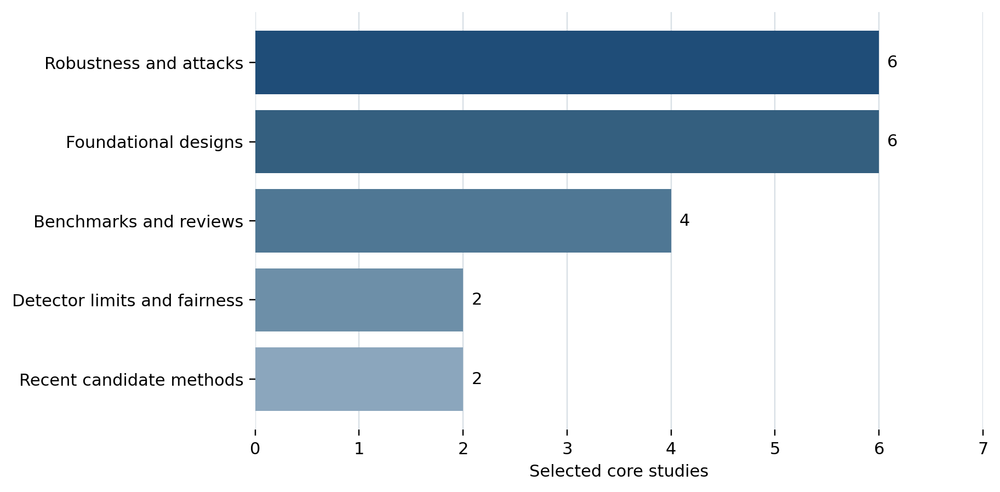

**CYBERSECURITY WHITE PAPER**

**A Cybersecurity Architecture for LLM Text Watermark Detection and Controlled Watermarking**

Detection, controlled creation, stress testing, and governance

**Daniel Boles \| August 14, 2026**

*Design and evidence draft. Empirical application validation is pending.*

# Executive summary

LLM text watermarks can help establish provenance, but they cannot safely operate as a simple “AI detector.” The strongest academic work shows that watermarking is a security system with keys, threat models, calibration requirements, evasion attacks, spoofing risks, and unavoidable trade-offs. A useful implementation must therefore combine statistical verification, controlled generation, attack testing, audit records, and human review.

The recommended application is a research-grade watermark laboratory with four distinct findings: verified-compatible watermark, not detected, inconclusive, and keyless forensic signal. It should never output a generic percentage of AI authorship. A provider watermark may indicate that text was processed by a model, but that can include proofreading, translation, summarization, or formatting. It does not prove that the model created the author’s ideas or wrote the entire document.

The technical approach should be Python-first, with Rust introduced only for high-volume scoring, keyed pseudorandom functions, alignment, and secure memory handling. PySide6 is recommended for the Windows GUI. PostgreSQL should preserve immutable run records. Jupyter and Polars should support calibration and research. A Docker mock provider should let a team build the application before connecting to Anthropic or any production model service.

Three research adapters are proposed: KGW-style watermarking as the interpretable baseline, MCmark-inspired multi-channel watermarking as an experimental unbiased method, and MirrorMark-inspired multi-bit watermarking as an experimental payload method. The words “inspired” and “experimental” matter. Technical similarity does not establish compatibility with Claude or any provider.

The central recommendation is straightforward: build the application first, validate it on project-owned synthetic data, and connect to Anthropic only when an authorized detector or sufficiently documented interface exists. Azure OpenAI, GPT-5.6 Luna, Kimi 2.7 Code, GLM 5.2, and other non-Anthropic models can propose hypotheses and generate adversarial tests. They cannot recover Claude’s secret watermark through intuition alone.

# 1. The problem is provenance, not style

Generic AI-text detectors classify style. A watermark detector tests for a deliberately embedded statistical signal. These are different evidential systems.

The first distinction is especially important for academic editing. Liang et al. (2023) found that several GPT detectors disproportionately flagged writing by non-native English authors. RAID later showed that detector performance changes across models, domains, decoding strategies, and attacks (Dugan et al., 2024). A confident style score can therefore be wrong for exactly the kinds of multilingual academic manuscripts that language services handle.

A keyed watermark detector is more specific, but it still has limits. It needs the compatible tokenizer, normalization rules, key or verification interface, threshold, and enough text. Short passages, low-entropy outputs, translation, paraphrasing, mixing, and editing can reduce detection. A positive result also requires careful interpretation. Anthropic’s current documentation says a Claude mark may indicate that material was processed by Claude, including proofreading and translation. That is broader than authorship.

Provenance should therefore be treated as a chain of evidence:

1.  File and revision history

2.  Declared AI use

3.  Model and API logs when available

4.  Compatible watermark verification

5.  Statistical and stylistic forensic analysis

6.  Human review of the workflow and document quality

No single layer should automatically determine misconduct, rejection of a submission, or discipline.

# 2. What the research establishes

Kirchenbauer et al. (2023) introduced an influential scheme that divides candidate tokens into keyed green and red sets and biases generation toward the green set. Detection tests whether the resulting green-token count is unusually high. This method is interpretable and useful as a first reproducible baseline.

Later work pursued stronger guarantees. Kuditipudi et al. (2024) proposed distortion-free watermarking under a generation budget. Hu et al. (2024) developed an unbiased construction that preserves the marginal output distribution under stated assumptions. Christ et al. (2024) examined cryptographically undetectable watermarks, while Zhao et al. (2024) developed provable robustness under a formal edit model. SynthID-Text demonstrated a scalable deployment-oriented design (Dathathri et al., 2024).

These contributions do not eliminate the trade-off. The SoK by Zhao et al. (2025), which includes an Anthropic-affiliated coauthor, concludes that watermarking is valuable but not a complete solution. Pang et al. (2024) and Zhang et al. (2024) provide formal reasons that strong robustness, quality, and usability cannot be assumed simultaneously.

Attack research matters as much as construction research. Translation can reduce some tested watermarks toward random-guessing performance (He et al., 2024). Color-aware substitutions can infer and exploit token classes (Wu & Chandrasekaran, 2024). Paraphrasing can evade both generic detectors and some watermark configurations (Krishna et al., 2023). MCmark and MirrorMark report improved properties under selected conditions, but their robustness varies substantially by attack, payload, model, and threshold (Chen et al., 2025; Jiang et al., 2026).

*Figure 1. Distribution of the core evidence corpus by research role.*

The figure maps the 20-paper core corpus used for this design. It is not a bibliometric estimate of the whole field. The large robustness category reflects the security importance of testing removal, spoofing, and false-positive behavior.

# 3. Recommended application modes

| **Mode** | **Question answered** | **Evidence strength** | **Required warning** |
|----|----|----|----|
| Verify | Does this text contain a compatible keyed watermark? | Highest when calibrated and compatible | Positive means compatible processing, not complete authorship |
| Create | Can the operator generate text carrying its own controlled watermark? | Known because the operator controls method and key | Requires disclosure and key governance |
| Analyze | Does unknown text contain unusual token-level structure? | Exploratory | Cannot identify a provider without compatibility evidence |
| Stress test | Does a known watermark survive a defined transformation? | Experimental and reproducible | Result applies only to the tested configuration |
| Compare | How do methods perform under matched conditions? | Strong if conditions are harmonized | Cross-paper headline values are not directly comparable |

Every selected method should run separately. The comparison screen may aggregate completed runs, but it should not collapse KGW, MCmark-inspired, MirrorMark-inspired, style classifiers, and model opinions into one “AI percentage.”

# 4. Technical architecture

The MVP should be a modular Python desktop application. Python offers the strongest combination of statistical libraries, NLP tooling, model clients, notebooks, document extraction, and rapid paper reproduction. PySide6 provides official Qt bindings and a mature Windows GUI. PostgreSQL provides structured audit history, JSONB configuration, indexing, and reliable migrations.

Rust should be added through PyO3 and maturin after the Python reference methods pass golden-vector tests. Rust is a good fit for keyed pseudorandom generation, rolling context hashes, token-class partitioning, dynamic-programming alignment, secure key buffers, and batch scoring. It should not become the main research language before the algorithms stabilize.

Custom C++ is not recommended for the MVP. Qt, ONNX Runtime, and tokenizer libraries already contain optimized native code. Adding original C++ would create a third implementation language and a larger security and packaging burden without a clear benefit.

| **Layer** | **Recommended technology** | **Security reason** |
|----|----|----|
| GUI | PySide6 | Mature local file workflow and explicit user review |
| Run engine | Python, Pydantic, Typer | Typed manifests and fast research iteration |
| Statistical methods | NumPy and SciPy | Transparent reference implementation |
| Fast core | Rust, PyO3, zeroize | Memory safety and controlled secret handling |
| Tokenizers | Hugging Face Tokenizers, tiktoken, SentencePiece | Exact model-specific tokenization |
| Analytics | Polars, Arrow, Parquet, Jupyter | Reproducible high-volume analysis |
| Database | PostgreSQL, SQLAlchemy, Alembic | Transactional audit trail and migrations |
| Local inference | ONNX Runtime | Cross-platform classifier deployment |
| Model gateway | OpenAI SDK, Azure Identity, HTTPX | Provider-neutral boundary adapters |
| Test provider | FastAPI in Docker | Deterministic fixtures and fault injection |
| Windows release | PyInstaller one-folder, later MSIX/WiX | Easier diagnostics before formal installer hardening |

# 5. Non-Anthropic models as a forensic ensemble

Azure OpenAI, GPT-5.6 Luna, Kimi 2.7 Code, GLM 5.2, and other non-Anthropic models can improve research without giving them final authority.

They can:

- propose measurable hypotheses about token distributions or repeated structures;

- generate paraphrase, translation, deletion, insertion, and mixing attacks;

- review equations and implementation choices;

- label passages for experimental supervised learning;

- challenge alternative explanations for a statistical result; and

- help develop tests and documentation.

They cannot:

- know Claude’s unpublished secret key;

- validate a proprietary watermark without a compatible detector;

- convert stylistic resemblance into proof of Claude provenance;

- determine whether Claude generated, proofread, or translated a passage from prose alone; or

- replace held-out calibration and false-positive analysis.

Each model’s response should be stored independently with model profile, version, sampling settings, prompt hash, and response hash. The final decision layer should accept only preregistered deterministic features that pass held-out tests. Averaging several model opinions does not turn opinion into verification.

# 6. Mock provider before Anthropic integration

The Docker mock should expose both an Anthropic-shaped \`/v1/messages\` endpoint and an OpenAI-compatible \`/v1/chat/completions\` endpoint. It should generate deterministic clean and watermarked fixtures and later simulate timeouts, malformed responses, rate limits, token-budget errors, and model-version drift.

The mock must visibly identify itself as simulated. It should not reproduce Anthropic branding or claim that its output resembles Claude. Its purpose is application engineering: intake, jobs, retries, artifact storage, GUI status, error handling, and reports can all be built before production credentials exist.

# 7. Cybersecurity controls

## 7.1 DeepL and translation provenance

DeepL currently documents an optional visible “Translated by DeepL” watermark for DOCX and PDF file translation. The API exposes this through \`enable_watermark\`. The reviewed official material does not describe an invisible statistical watermark in translated word choices or a public detector for pasted DeepL text. The application should therefore detect the visible document object when present, preserve authorized API metadata, and classify invisible DeepL attribution as unsupported.

DeepL remains important even without a documented hidden watermark. Academic studies use translation and back translation as watermark attacks. The application should include DeepL as an authorized transformation adapter and test how it changes project-controlled KGW, MCmark-inspired, and MirrorMark-inspired signals.

## 7.2 Platform-neutral anomaly scanning

Known detector plugins are not enough. The application should also scan for unexplained hidden characters, bidirectional controls, homoglyphs, abnormal Unicode normalization, whitespace channels, acrostics, periodic lexical choices, token schedules, hidden Word text, comments, revisions, fields, custom XML, external links, PDF overlays, and unusual metadata.

These findings should be reported as deterministic hidden objects, container anomalies, statistical anomalies, reproduced covert channels, or unresolved patterns. None of these labels implies AI authorship.

## 7.3 Key management

Watermark keys are security credentials. They should be stored in Azure Key Vault for Azure deployments and Windows Credential Manager or DPAPI-protected storage for local development. The database, reports, notebooks, screenshots, prompts, and logs should contain only opaque key identifiers.

Creation and verification roles should be separable. Key rotation must preserve the ability to verify authorized historical outputs without reactivating an old creation key.

## 7.4 Immutable evidence

Every run should record:

- original and normalized SHA-256 hashes;

- extraction method and source path;

- tokenizer files, revision, and hash;

- method and implementation version;

- key ID, not key value;

- model endpoint and version;

- threshold and expected false-positive rate;

- random seed and transformation configuration;

- code commit; and

- hashes of every artifact and report.

## 7.5 Human review and decision language

The application should use four outcomes: verified-compatible watermark, not detected, inconclusive, and keyless forensic signal. It should not output “human-written” because non-detection cannot establish that conclusion.

A positive result should trigger a provenance review. The reviewer should examine the author’s disclosure, revision history, editing workflow, model logs, and whether the reviewing service itself processed the document through a watermarking model.

## 7.6 Third-party text and disclosure

The MVP should prohibit third-party manuscripts by default. Initial testing should use synthetic text, public-domain text, licensed research corpora, or project-owned demonstrations. Watermark creation should initially operate only during generation. Rewriting existing human prose to force a watermark is riskier because it can alter meaning and blur authorship.

If third-party use is later approved, the operator should disclose that AI processing may add a statistical mark. The policy should distinguish original authorship, AI processing, human editing, and final responsibility.

# 8. Risk register

| **Risk** | **Likelihood** | **Impact** | **Primary control** |
|----|----|----|----|
| False accusation from an uncalibrated score | Medium | Severe | Four-outcome policy, matched calibration, human review |
| Watermark removal by paraphrase or translation | High | High | Attack testing, provenance logs, layered evidence |
| Spoofed public watermark | Medium | High | Secret-key verification, signed manifests, key rotation |
| Key exposure in logs or notebooks | Medium | Severe | Vault storage, redaction, opaque key IDs, secret scanning |
| Model ensemble overclaims Claude attribution | High | High | Keyless label, holdout testing, provider attribution disabled |
| The operator adds a mark during proofreading | Medium | High | Disclosure, workflow metadata, generation-versus-edit distinction |
| Tokenizer or model drift breaks verification | High | High | Pin and hash tokenizer/model versions, historical adapters |
| Research implementation differs from paper | Medium | High | Kimi ingestion gate, GLM independent audit, golden vectors |

# 9. Implementation roadmap

Phase 1 should deliver intake, immutable manifests, the Docker mock, PostgreSQL records, GUI navigation, and a KGW reference implementation. Phase 2 should add attack testing, passage localization, and calibration notebooks. Phase 3 should reproduce MCmark. Phase 4 should reproduce MirrorMark and separate presence from payload recovery. Phase 5 should add the provider-neutral forensic ensemble. Packaging and security hardening should follow stable functionality. A real Anthropic adapter belongs last.

The first release should remain a laboratory rather than a disciplinary tool. This is not a weakness. It is the correct security posture for a field where both false confidence and adversarial removal are well documented.

# 10. Open design questions

1.  Permit only generation-time watermarking in the first release?

2.  Prohibit third-party documents until a governed pilot?

3.  Use PostgreSQL only, or allow a clearly labeled SQLite demonstration mode?

4.  Begin with English only, or include additional languages in the first calibration corpus?

5.  Use a binary mark or an encrypted payload containing project and workflow identifiers?

# References

Chen, H., et al. (2025). Improved unbiased watermark for large language models. *Proceedings of ACL 2025*, 19631–19651. https://doi.org/10.18653/v1/2025.acl-long.1005

Christ, M., Gunn, S., & Zamir, O. (2024). Undetectable watermarks for language models. *Proceedings of COLT 2024*, 1125–1139. https://proceedings.mlr.press/v247/christ24a.html

Dathathri, S., et al. (2024). Scalable watermarking for identifying large language model outputs. *Nature, 634*, 818–823. https://doi.org/10.1038/s41586-024-08025-4

Dugan, L., et al. (2024). RAID: A shared benchmark for robust evaluation of machine-generated text detectors. *Proceedings of ACL 2024*, 12463–12492. https://doi.org/10.18653/v1/2024.acl-long.674

He, Z., et al. (2024). Can watermarks survive translation? On the cross-lingual consistency of text watermark for large language models. *Proceedings of ACL 2024*, 4115–4129. https://doi.org/10.18653/v1/2024.acl-long.226

Hu, Z., Chen, L., Wu, X., Wu, Y., Zhang, H., & Huang, H. (2024). Unbiased watermark for large language models. *International Conference on Learning Representations*. https://openreview.net/forum?id=uWVC5FVidc

Jiang, Y., Kordi Boroujeny, M., Suresh Kumar, S., & Zeng, K. (2026). MirrorMark: A robust multi-bit watermark for large language models. *arXiv preprint arXiv:2601.22246v3*. https://arxiv.org/abs/2601.22246

Kirchenbauer, J., Geiping, J., Wen, Y., Katz, J., Miers, I., & Goldstein, T. (2023). A watermark for large language models. *Proceedings of ICML 2023*, 17061–17084. https://proceedings.mlr.press/v202/kirchenbauer23a.html

Kirchenbauer, J., Geiping, J., Wen, Y., Shu, M., Saifullah, K., Kong, K., Fernando, K., Saha, A., Goldblum, M., & Goldstein, T. (2024). On the reliability of watermarks for large language models. *International Conference on Learning Representations*. https://openreview.net/forum?id=aX8ig9X2a7

Krishna, K., Song, Y., Karpinska, M., Wieting, J., & Iyyer, M. (2023). Paraphrasing evades detectors of AI-generated text, but retrieval is an effective defense. *Advances in Neural Information Processing Systems, 36*. https://proceedings.neurips.cc/paper_files/paper/2023/hash/575c450013d0e99e4b0ecf82bd1afaa4-Abstract-Conference.html

Kuditipudi, R., Thickstun, J., Hashimoto, T., & Liang, P. (2024). Robust distortion-free watermarks for language models. *Transactions on Machine Learning Research*. https://openreview.net/forum?id=FpaCL1MO2C

Liang, W., et al. (2023). GPT detectors are biased against non-native English writers. *Patterns, 4*(7), 100779. https://doi.org/10.1016/j.patter.2023.100779

Pang, Q., et al. (2024). No free lunch in LLM watermarking: Trade-offs in watermarking design. *Advances in Neural Information Processing Systems, 37*. https://proceedings.neurips.cc/paper_files/paper/2024/hash/fa86a9c7b9f341716ccb679d1aeb9afa-Abstract-Conference.html

Wu, Y., & Chandrasekaran, V. (2024). Bypassing LLM watermarks with color-aware substitutions. *Proceedings of ACL 2024*, 8477–8490. https://doi.org/10.18653/v1/2024.acl-long.464

Zhao, X., et al. (2025). SoK: Watermarking for AI-generated content. *2025 IEEE Symposium on Security and Privacy*. https://doi.org/10.1109/SP61157.2025.00178

DeepL. (2026). Upload and translate a document: \`enable_watermark\`. *DeepL API documentation*. https://developers.deepl.com/api-reference/document/upload-and-translate-a-document
