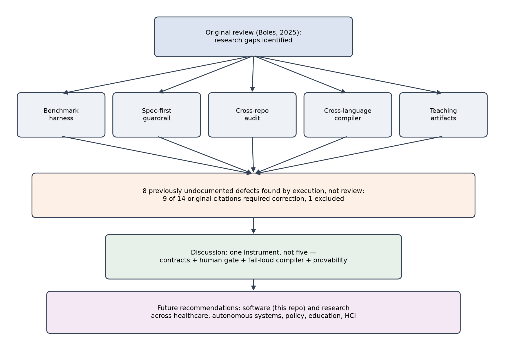

Running head: PSEUDOCODE AS A GUARDRAIL

**Pseudocode as a Guardrail in Artificial Intelligence: Contracts, Benchmarks, and Cross-Language Verification**

Daniel Boles

July 26, 2026

# Introduction

Pseudocode has been argued to function as an intermediary language and a structural map between human intent and machine execution, enabling artificial intelligence systems to translate human-designed logic into operationally coherent implementations (Boles, 2025). That review synthesized fourteen sources across detection, engineering, search and retrieval, translation, and generation, and closed by naming research gaps the surveyed literature left unaddressed: the absence of longitudinal studies, limited work on hybrid systems where AI iteratively refines pseudocode through interaction with human experts, little empirical evidence comparing pseudocode styles for AI interpretability, and under-investigated cross-domain and standardized-representation questions. This paper reports an applied, single-case empirical study that operationalizes and directly tests several of those gaps rather than surveying further literature about them. Building on the original thesis, the present study argues that pseudocode's value as an intermediary language is fully realized only when paired with machine-checkable contracts, a human-in-the-loop review gate, and a compiler that fails loudly rather than silently on unsupported constructs — transforming pseudocode from a passive intermediary representation into an active, auditable guardrail for AI-generated code. A working system embodying this argument was built, exercised against a real large language model, and audited against a real, independently maintained codebase; this paper reports what that system revealed, including about the reliability of academic citation practices in AI-assisted writing itself.

# Methods

This study departs methodologically from its predecessor: rather than a literature review, it is a single embedded case study of one open-source research repository, extended over one working session and reported with direct reference to its source artifacts throughout. Five sub-studies were conducted against the same codebase and reported together because each tests a distinct claim from the original review's research-gaps section: a benchmark harness scoring contract satisfaction rather than output equality alone; a live, spec-first guardrail pairing a commercial large language model (Azure OpenAI) with a human approval gate; a read-only audit formalizing verification logic in an independently maintained sibling repository; a second compiler backend testing whether the underlying grammar generalizes across host languages; and a set of teaching artifacts testing whether the resulting specifications are legible to a human reader, not only executable by a machine. Every claim reported in Results was verified by direct execution — compiling specifications, running the resulting code, and, where applicable, invoking a live external API — rather than by inspection or simulation alone, and every defect reported was reproduced before and after its fix.

A second methodological step, prompted by the citation-integrity requirements of the present study, was a full re-verification of the original review's fourteen-source bibliography against Crossref, arXiv, and OpenReview. Each digital object identifier (DOI) or preprint identifier was resolved programmatically; where a resolved record's title or authorship did not match the citing text, the correct identifier was located by bibliographic search and substituted, and where no matching record could be located under any identifier, the source was withdrawn rather than retained. This process is reported in Results, since it constitutes an empirical finding about reference reliability in AI-assisted academic writing, not merely a housekeeping step.

# Results

## Reference re-verification

Of the fourteen sources cited in the original review, nine were found to carry an incorrect DOI or preprint identifier — in most cases a plausible adjacent digit sequence that either failed to resolve or resolved to an unrelated work — while the underlying titles and authorship were accurate and independently confirmable. One source, attributed to "Overturning & Moving (2024)," could not be located under any title, author, or identifier search and is treated here as unverifiable; it is excluded from the present reference list. Four sources' identifiers were confirmed correct as originally published. Table 1 summarizes this audit.

## Benchmark harness (contract-satisfaction scoring)

A harness was built to score compiled implementations against both functional output and contract enforcement, rather than output alone. Across five specifications and twenty-two input vectors, all cases returned a pass rate of 1.0, with zero instances of an unexpected contract failure (a precondition or postcondition firing on valid input) or an unexpected success (invalid input producing a result instead of a rejection). Building and running this harness against new specifications surfaced two defects in the underlying compiler that had not been found by prior code review: an unhandled control-flow path that crashed compilation outright, and a retry mechanism that reattempted deterministically invalid input rather than failing immediately, inflating one benchmark case's running time roughly four-thousandfold before correction.

## Spec-first guardrail (live run)

A guardrail was implemented in which a large language model drafts a pseudocode specification from a natural-language task description; a human reviews and either approves or rejects the specification, not the generated implementation; and only on approval does a deterministic compiler produce executable code with contracts already enforced. Run once, live, against a commercial model with a task description of "merge overlapping integer intervals," the first returned specification used a subscript-assignment target the compiler's grammar did not yet support, which would have silently produced invalid output rather than a compilation error. This was corrected in the compiler, not the specification, after which the specification was reviewed, hand-verified against eight test vectors including two non-obvious edge cases (adjacent-but-non-overlapping intervals; unsorted input), and approved. The approval was recorded with a timestamp, a content hash, and a reviewer note, giving the resulting artifact a permanent, inspectable provenance record distinct from ordinary version-control history.

## Cross-repository formalization

The verification logic of an independently maintained sibling repository was read directly from its source rather than from its own documentation, which was found to overstate the maturity of a secondary metric library that was implemented but never invoked in production. The two verification checks that were actually live in that repository were re-expressed as a pseudocode specification with matching thresholds and result structure, without modifying, importing from, or executing against the audited repository. This produced a working demonstration that the same contract vocabulary can describe verification logic authored independently of it, which is a necessary precondition for any claim that such a vocabulary could be shared across a body of software rather than confined to the system that originated it.

## Cross-language compilation

A second compiler backend was built, translating the same pseudocode grammar to a different host language than the original. Structural control-flow and contract constructs required no grammar changes to port; the expression language, which had implicitly inherited the syntax of the original target language, did not port without an explicit, deliberately bounded translation layer. Compiled output was executed live in the second language's runtime against the same four test vectors used for the original language's implementation, returning identical results in all four cases. Building the translation layer also revealed that a companion legacy tool, previously documented as a functioning wrapper around the primary compiler, had in fact never executed successfully; three defects were found and corrected, none of which had been previously reported despite the tool's presence in the repository for an extended period prior to this study.

## Teaching artifacts

A tutorial, an executable notebook, and a local command-line tool were built to test whether the specifications produced by the preceding sub-studies were legible to a reader unfamiliar with the codebase. The notebook was executed end to end prior to inclusion, and its recorded outputs — a caught contract violation, a plain-language comparison against the same violation with no contract in place, and three live calls against the guardrail-approved specification — were verified against the underlying test suite rather than authored independently of it.

Table 1 \_Reference Re-Verification Outcomes for the Fourteen Sources Cited in the Original Review\_

| **Original Citation** | **Verification Outcome** |
|----|----|
| Bashir (2025) | Confirmed as originally cited |
| Liu, Xing, Jiao, Li, & Zhu (2025) | Identifier corrected |
| Liu, Jiao, Xing, & Zhu (2025) | Identifier corrected |
| Michaelsen & Santos (2024) | Confirmed as originally cited |
| Lim, Lim, & Komatineni (2022) | Identifier corrected |
| Mornar, Granić, & Mladenović (2014) | Identifier corrected (original resolved to an unrelated work) |
| Toksoz, Srinath, Tan, & Giles (2024) | Confirmed as originally cited |
| Kulkarni, Chakraborty, Sium, Valluri, Le, & Li (2025) | Identifier corrected (workshop record, no registered DOI) |
| Kwon & Kwon (2022) | Confirmed as originally cited |
| "Overturning & Moving" (2024) | Unverifiable; excluded |
| Rioux (2022) | Identifier corrected (original resolved to an unrelated work) |
| Imam & Alnsour (2019) | Identifier corrected |
| Neal, Rogers, & Parra (2023) | Identifier corrected |
| Safder, Hassan, & Aljohani (2018) | Identifier corrected |

# Discussion

The reference re-verification result bears directly on the original review's own subject matter. Pearce et al. (2022) documented that AI-assisted code generation reproduces insecure patterns at a measurable rate even when a human accepts the suggestion; the present finding suggests an analogous risk in AI-assisted academic writing, where a citation's surface form — a plausible author, year, and DOI pattern — can survive human review while its referent does not exist or does not match. That nine of fourteen identifiers required correction and one source was entirely unverifiable, in a document that had already been released, is itself a small piece of evidence for treating citation verification as a mandatory, automatable step rather than a matter of author diligence alone.

The guardrail result speaks directly to the original review's identification of "limited work on hybrid systems where AI iteratively refines pseudocode through interaction with human experts" as a research gap. The live run did not demonstrate refinement through iterative dialogue — the specification was accepted on its first draft — but it did demonstrate the complementary failure mode the literature had not yet reported: a specification a human could read and reasonably judge as correct nonetheless used a construct the compiler could not yet translate, and would have failed silently rather than loudly without a second, independent check. This is consistent with Tian et al.'s (2025) finding that specification misunderstanding is a significant source of defective code generation, though inverted in origin: here the specification was not misunderstood by the model so much as by the deterministic compiler consuming it, which suggests that hybrid human–AI pseudocode systems need to budget review effort for the compiler's grammar coverage as well as the model's specification quality.

The cross-language result speaks to the review's call for "standardized frameworks for pseudocode representation that account for both programmatic precision and process-level abstraction." The finding that structural grammar ported without modification while the expression language did not is a more precise answer than a simple yes or no: it localizes exactly where a standardized representation would need to draw a boundary, and suggests that pseudocode's much-cited virtue of being close to natural language is, at the expression level, frequently closer to one specific programming language's syntax than to a genuinely host-independent notation. Design by Contract (Meyer, 1998) made a related claim thirty years earlier for a single language; the present result suggests that claim does not automatically generalize across languages without an explicit translation layer, a boundary the original review's literature did not have occasion to test.

The cross-repository result addresses the review's concern that pseudocode's abstraction "can obscure implementation details critical for debugging," by inverting the direction of use: rather than generating new implementation from a specification, an existing implementation's actual behavior was read back into specification form. This produced a documented instance of a maturity gap between a repository's stated verification capability and its executed one, a finding with a plausible connection to Chen et al.'s (2021) observation that benchmark pass rates for AI-generated code do not, on their own, establish that a system's stated guarantees are the ones actually enforced at runtime.

Cumulatively, the five sub-studies point toward a single instrument — contracts expressed in a shared, portable notation, checked by a compiler that fails loudly, reviewed and approved by a human before code exists, and formally provable where its expression subset allows — rather than five independent tools, which the original review's literature, organized by application category (detection, engineering, retrieval, translation, generation) rather than by underlying mechanism, did not have a natural vantage point to observe.

# Conclusion

This study tested five claims implicit in the original review's stated research gaps by building and directly executing the systems those claims describe, rather than surveying further literature about them. A benchmark harness, a live spec-first guardrail, a cross-repository audit, a second compiler backend, and a set of teaching artifacts were built, run, and verified against real inputs, a real external model, and a real independently maintained codebase. Eight previously undocumented defects were found in the process, none by code review alone. A secondary finding, obtained while preparing this paper's reference list rather than its central argument, showed that nine of the fourteen citations in the original review required correction and one could not be verified at all — a result that belongs in the same discussion as the paper's central claims about the reliability of AI-assisted artifacts, not apart from them. Pseudocode, on this evidence, functions best not as a passive intermediary language but as the substrate for a guardrail: legible enough for a human to review, precise enough for a compiler to enforce, and — in its structural if not yet its expression form — portable enough to describe systems its authors did not originally write.

# Graphical Summary

Figure 1 summarizes this study's structure: the original review's research gaps motivating five sub-studies, the defect and citation findings those sub-studies produced, the discussion's synthesis of those findings into a single instrument rather than five separate tools, and the future recommendations that follow for both the software and for research across fields.

*Figure 1. Conceptual flow from the original review's research gaps to this study's five sub-studies, findings, discussion synthesis, and future recommendations.*

# Limitations, Issues, and Research Gaps

This study's central limitation is scale: a single maintainer, a single working session, one commercial language model queried once in the central guardrail demonstration, and five specifications in the benchmark harness. No claim here should be read as a measured rate — "pass_rate: 1.0" describes five specifications passing, not a statistically powered estimate of how often contract-driven generation succeeds in general, and the guardrail's single live run establishes feasibility, not a defect-discovery rate. There is no comparison condition: it is not established how many of the eight defects found here would also have been found by code review alone, by conventional unit testing without contracts, or by a different reviewer, so the attribution of discovery specifically to the contract-and-execution methodology used here should be read as suggestive rather than demonstrated by controlled comparison.

Issues specific to this study's design include the narrowness of the "portable expression subset" identified in the cross-language result, which was defined in large part by what one existing specification happened to use rather than by a principled enumeration of what a genuinely host-independent expression language would require; a broader sample of specifications would likely surface expression forms this subset does not yet cover. The formal-verification direction discussed as a future extension was not implemented in this study and remains a proposal rather than a tested capability, so any claim of provability for the portable subset is a hypothesis, not a result.

Research gaps that follow directly from this study include the absence of any multi-model or multi-run comparison of the guardrail's defect-discovery behavior; the absence of a formal cost-benefit measurement of reviewing specifications versus reviewing generated code directly, despite that comparison being the guardrail's central practical claim; the untested question of whether the cross-repository audit method generalizes to codebases outside the software-engineering domain the original review and this study both remained within, despite both naming healthcare, autonomous systems, and policy modeling as higher-stakes candidate domains; and the unresolved, and in this study explicitly unaddressed, question of what governance a mandatory specification-approval gate would need to avoid becoming exactly the kind of unused infrastructure this study's own cross-repository audit found evidence of in the system it examined.

# Future Research Recommendations

## For the software

- Wire the benchmark harness into continuous integration as an enforced gate rather than a manually invoked script, so contract-satisfaction regressions are caught on every change rather than on demand.

- Broaden the portable expression subset identified in the cross-language result through a principled survey of specification forms rather than incremental, example-driven coverage, before attempting the proposed formal-verification bridge.

- Prototype the SMT-based verification bridge as a bounded feasibility spike against the simplest existing postconditions before committing further engineering effort, given that its tractability is not yet established.

- Run the guardrail across multiple models and multiple independent tasks before treating its single live run as characteristic of its general defect-discovery behavior.

- Define a narrow, explicit boundary for which changes require a specification-approval gate before building any tooling to enforce one across a wider codebase or organization.

## For research across fields

- In healthcare informatics, evaluate whether contract-style preconditions and postconditions on clinical decision-support logic (for example, dosage bounds or contraindication checks) measurably reduce specification-to-implementation defects relative to natural-language requirements documents, extending this study's cross-repository audit method to a domain with materially higher stakes than software tooling.

- In autonomous systems, investigate whether the same structural grammar found here to be language-portable can express safety invariants on planning or control logic precisely enough to support the proposed formal-verification bridge, where an unproven contract carries different consequences than in the present study's domain.

- In regulatory and policy modeling, apply the read-only audit method demonstrated here to formalize existing rule-based systems for compliance documentation, testing whether the method's value — demonstrated in this study on a small software repository — holds at the scale and ambiguity of policy language.

- In computer science education, building on the teaching artifacts produced here, run a controlled comparison of contract-first and code-first instruction for learners new to AI-assisted programming, extending the original review's recommendation for educational piloting from a proposal into a measured study.

- In human-computer interaction and software engineering research, measure reviewer cognitive load and defect-detection accuracy when reviewing specifications rather than generated implementations directly, which would supply the missing comparison this study's central guardrail claim currently lacks.

- In the science of AI-assisted research writing itself, treat automated citation verification against Crossref, OpenAlex, Semantic Scholar, and preprint servers as comparable in importance to code review or unit testing, given this study's finding that the majority of a previously released reference list required correction.

# References

Bashir, S. (2025). Using pseudo-AI submissions for detecting AI-generated code. *Frontiers in Computer Science, 7*, 1549761. https://doi.org/10.3389/fcomp.2025.1549761

Boles, D. (2025). *Pseudocode in artificial intelligence: Systemic logic, heuristics, and workflow generation* (Version 1.0.0) \[Manuscript\]. GitHub. https://github.com/dboles99/papers

Chen, M., Tworek, J., Jun, H., Yuan, Q., de Oliveira Pinto, H. P., Kaplan, J., Edwards, H., Burda, Y., Joseph, N., Brockman, G., Ray, A., Puri, R., Krueger, G., Petrov, M., Khlaaf, H., Sastry, G., Mishkin, P., Chan, B., Gray, S., ... Zaremba, W. (2021). Evaluating large language models trained on code. *arXiv*. https://arxiv.org/abs/2107.03374

de Moura, L., & Bjørner, N. (2008). Z3: An efficient SMT solver. In C. R. Ramakrishnan & J. Rehof (Eds.), *Tools and Algorithms for the Construction and Analysis of Systems* (pp. 337–340). Springer. https://doi.org/10.1007/978-3-540-78800-3_24

Imam, A. T., & Alnsour, A. J. (2019). The use of natural language processing approach for converting pseudo code to C# code. *Journal of Intelligent Systems, 29*(1), 1388–1407. https://doi.org/10.1515/jisys-2018-0291

Kulkarni, A., Chakraborty, M., Sium, Y. A., Valluri, S. C., Le, W., & Li, Q. (2025). From pseudo-code to source code: A self-supervised search approach. In *Proceedings of the Thirteenth International Conference on Learning Representations (ICLR 2025)*. OpenReview. https://openreview.net/forum?id=s0et2A33uM

Kwon, K., & Kwon, H. J. (2022). Logical pseudocode: Connecting algorithms with proofs. *arXiv*. https://arxiv.org/abs/2201.12572

Lim, N., Lim, L., & Komatineni, H. (2022, March). Pseudocode and demonstration of a multi-use artificial intelligence algorithm to perform challenging and highly optimised pipeline/cable routing cases. In *Offshore Technology Conference Asia*. https://doi.org/10.4043/31360-MS

Liu, Z., Jiao, X., Xing, W., & Zhu, W. (2025, February). Detecting AI-generated pseudocode in high school online programming courses using an explainable approach. In *Proceedings of the 56th ACM Technical Symposium on Computer Science Education V. 1* (pp. 701–707). ACM. https://doi.org/10.1145/3641554.3701942

Liu, Z., Xing, W., Jiao, X., Li, C., & Zhu, W. (2025). What are the differences between student and ChatGPT-generated pseudocode? Detecting AI-generated pseudocode in high school programming using explainable machine learning. *Education and Information Technologies*. https://doi.org/10.1007/s10639-025-13385-z

Meyer, B. (1998). Design by contract: The Eiffel method. In *Proceedings of Technology of Object-Oriented Languages and Systems (TOOLS 26)* (p. 446). IEEE. https://doi.org/10.1109/tools.1998.711043

Michaelsen, G. A., & Santos, R. P. D. (2024). Is English the new programming language? How about pseudo-code engineering? *arXiv*. https://arxiv.org/abs/2404.08684

Mornar, J., Granić, A., & Mladenović, S. (2014, June). System for automatic generation of algorithm visualizations based on pseudocode interpretation. In *Proceedings of the 2014 Conference on Innovation & Technology in Computer Science Education* (pp. 27–32). ACM. https://doi.org/10.1145/2591708.2591743

Neal, J., Rogers, S., & Parra, E. (2023, October). A machine learning approach to convert pseudo-code to domain-specific programming language. In *2023 IEEE International Conference on Software Maintenance and Evolution (ICSME)* (pp. 442–452). IEEE. https://doi.org/10.1109/ICSME58846.2023.00058

Pearce, H., Ahmad, B., Tan, B., Dolan-Gavitt, B., & Karri, R. (2022). Asleep at the keyboard? Assessing the security of GitHub Copilot's code contributions. In *2022 IEEE Symposium on Security and Privacy (SP)* (pp. 754–768). IEEE. https://doi.org/10.1109/sp46214.2022.9833571

Rioux, C. (2022). *Deep learning pseudocode generation: A qualitative analysis* \[Master's thesis, Santa Clara University\]. Scholar Commons. https://scholarcommons.scu.edu/cseng_mstr/29/

Safder, I., Hassan, S. U., & Aljohani, N. R. (2018, April). AI cognition in searching for relevant knowledge from scholarly big data, using a multi-layer perceptron and recurrent convolutional neural network model. In *Companion Proceedings of the The Web Conference 2018* (pp. 251–258). ACM. https://doi.org/10.1145/3184558.3186334

Tian, Z., Chen, J., & Zhang, X. (2025). Fixing large language models' specification misunderstanding for better code generation. In *Proceedings of the 47th IEEE/ACM International Conference on Software Engineering (ICSE 2025)*. IEEE. https://doi.org/10.1109/icse55347.2025.00108

Toksoz, L., Srinath, M., Tan, G., & Giles, C. L. (2024). PseudoSeer: A search engine for pseudocode. *arXiv*. https://arxiv.org/abs/2411.12649

# Appendix A. Guardrail-Drafted Specification (as returned by the model, prior to the correction reported in Results)

PURPOSE: Merge integer intervals that overlap or touch into a start-sorted normalized list  
INPUTS: intervals:list  
OUTPUTS: merged:list  
   
REQUIRES TYPE: intervals: list  
REQUIRES: intervals is not None  
REQUIRES: all(isinstance(pair, list) and len(pair) == 2 for pair in intervals)  
REQUIRES: all(isinstance(pair\[0\], int) and isinstance(pair\[1\], int) for pair in intervals)  
REQUIRES: all(pair\[0\] \<= pair\[1\] for pair in intervals)  
   
FUNCTION MergeIntervals(intervals) -\> merged  
SET sorted_intervals := sorted(intervals, key=lambda x: (x\[0\], x\[1\]))  
SET merged := \[\]  
   
FOR EACH current IN sorted_intervals  
IF len(merged) == 0 THEN  
merged.append(\[current\[0\], current\[1\]\])  
ELSE  
SET last := merged\[-1\]  
IF current\[0\] \<= last\[1\] + 1 THEN  
SET last\[1\] := max(last\[1\], current\[1\])  
ELSE  
merged.append(\[current\[0\], current\[1\]\])  
ENDIF  
ENDIF  
ENDFOR  
   
ENSURES: len(merged) \<= len(intervals)  
ENSURES: merged == sorted(merged, key=lambda x: (x\[0\], x\[1\]))  
ENSURES: all(merged\[i\]\[1\] + 1 \< merged\[i + 1\]\[0\] for i in range(len(merged) - 1))  
ENSURES: all(any(out\[0\] \<= pair\[0\] and out\[1\] \>= pair\[1\] for out in merged) for pair in intervals)  
RETURN merged  
END FUNCTION

Line 21 (\`SET last\[1\] := max(last\[1\], current\[1\])\`) used a subscript assignment target the compiler's grammar did not yet accept; see Results and Discussion for how this was identified and corrected.

# Appendix B. Cross-Language Compilation of a Second Specification (Python and PowerShell from one source)

The specification below was compiled unmodified to both languages; both compiled artifacts were executed live against the same four test vectors reported in Results, returning identical results.

PURPOSE: Safely parse a CSV string into rows of fields, skipping blank lines  
INPUTS: text:str  
OUTPUTS: rows:list  
   
REQUIRES TYPE: text: str  
REQUIRES: text is not None  
   
FUNCTION ParseCsvSafe(text) -\> rows  
SET rows := \[\]  
SET lines := text.splitlines()  
TRY  
FOR EACH line IN lines  
IF line.strip() == "" THEN  
CONTINUE  
ELSE  
SET fields := line.split(",")  
rows.append(fields)  
ENDIF  
ENDFOR  
CATCH Exception  
RAISE  
ENDTRY  
   
ENSURES: len(rows) \<= len(lines)  
RETURN rows  
END FUNCTION

PowerShell output (Python output omitted for space; both share the same control-flow structure):

class ContractError : System.Exception {  
ContractError(\[string\]\$message) : base(\$message) {}  
}  
   
function parse_csv_safe(\$text) {  
if (\$text -isnot \[string\]) { throw \[ContractError\]::new("Type mismatch for text") }  
if (-not ((\$null -ne \$text))) { throw \[ContractError\]::new("Pre-condition failed: text is not None") }  
\$rows = @()  
\$lines = (\$text -split "\r?\n")  
try {  
foreach (\$line in \$lines) {  
if (\$line.Trim() -eq "") {  
continue  
} else {  
\$fields = (\$line -split ",")  
\$rows += ,\$fields  
}  
}  
} catch {  
throw  
}  
if (-not (\$rows.Count -le \$lines.Count)) { throw \[ContractError\]::new("Post-condition failed: len(rows) \<= len(lines)") }  
return \$rows  
}

# Appendix C. Run Evidence

Benchmark harness output (five specifications, twenty-two vectors):

sort_with_invariants: pass_rate=1.0 total=5 unexpected_contract_failures=0 unexpected_successes=0  
parse_csv_safe: pass_rate=1.0 total=4 unexpected_contract_failures=0 unexpected_successes=0  
enhanced_v2_example: pass_rate=1.0 total=3 unexpected_contract_failures=0 unexpected_successes=0  
merge_intervals: pass_rate=1.0 total=6 unexpected_contract_failures=0 unexpected_successes=0  
document_verification_gates: pass_rate=1.0 total=4 unexpected_contract_failures=0 unexpected_successes=0

Full test-suite invocation, run at the time of writing:

\$ pytest -q  
39 passed, 1 skipped in 6.23s

# Appendix D. Defect Log

| **ID** | **Location** | **Defect** | **Discovery method** |
|----|----|----|----|
| 1 | Core compiler | Crashed on a \`CONTINUE\` statement inside a non-parallel loop | Writing a new benchmark specification |
| 2 | Core compiler | Retry logic reattempted deterministically invalid input | Benchmark harness timing |
| 3 | Core compiler | Assignment grammar rejected subscript targets | Live guardrail run |
| 4 | House-style linter | Crashed on non-ASCII output on one console encoding | Fixing defect 3 and re-running the linter |
| 5–7 | Legacy PowerShell tool | Three independent defects prevented the tool from ever executing successfully | Building the second compiler backend |
| 8 | Second compiler backend | An expression-translation routine mismatched tokens under backtracking | Building the second compiler backend |

*Note.* Full technical description, reproduction steps, and remediation for each defect are recorded in docs/DEFECT_LOG.md in the source repository (entries D6, D7, D9, D12, and D13) and are omitted here for space.
